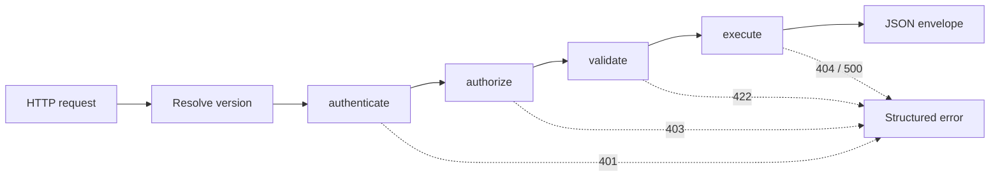

# config-driven-api-framework

An architecture overview and interface skeleton for a **configuration-driven REST API framework** for Node.js.

The idea: an endpoint is described as **data**, and a shared middleware pipeline does the repetitive work (authentication, permissions, input validation, API versioning, pagination and database access). Developers write the part that is specific to their product.

> **Scope of this repository.** This is a design showcase, not a runnable framework. The configuration format (`defineApi`), the route registry and the error types work and are tested. The pipeline steps, auth helpers and database adapters are documented interfaces that throw `not implemented`. The goal is to show the structure and the reasoning, not to ship the full implementation.

## The core idea

```js
defineApi({
  name: 'books.get',
  version: '1',
  method: 'GET',
  path: '/books/:id',
  auth: { required: true, permission: 'books:read' },
  params: { id: { type: 'integer', required: true, min: 1 } },
  query: {
    mode: 'one',
    sql: 'SELECT id, title, author FROM books WHERE id = :id AND deleted_at IS NULL',
  },
  response: { notFound: 'Book not found' },
});
```

That one declaration says who may call the endpoint, what input it accepts, which SQL it runs and what to return when nothing matches. No route handler, no token parsing, no validation code.

See [`examples/books.api.js`](examples/books.api.js) for a fuller example with two API versions side by side.

## Request flow



| Step | Responsibility |
|---|---|
| Resolve version | Picks the API version from a request header, defaulting to the latest registered version |
| `authenticate` | Verifies the bearer token and attaches the user to the request context |
| `authorize` | Checks the endpoint's declared permission against the user's permissions |
| `validate` | Merges, validates and coerces input; drops anything undeclared |
| `execute` | Runs the declarative query or custom handler and normalizes the result |

Steps are built **once at startup** from each definition, and a step is left out when it does not apply (for example, no `authorize` step on a public endpoint).

## Design decisions

- **Declarative first, escape hatch second.** Most endpoints are a query plus rules. When one needs real logic, it supplies a `handler` function and still gets the same auth, validation and versioning.
- **Fail at startup, not at request time.** `defineApi` rejects malformed definitions (bad method, missing query/handler, pagination on a non-list query) when the app boots.
- **Parameterized SQL only.** Queries use named placeholders that are compiled to driver placeholders, so user input is never concatenated into SQL.
- **Versioning without branching.** Several versions of one route live side by side in the registry; clients opt in with a header.
- **Pluggable persistence.** Everything talks to a small `BaseDatabase` interface, and drivers register with a factory.
- **Predictable responses.** Every success and error uses a fixed JSON envelope with a stable error code.

More detail in [`docs/architecture.md`](docs/architecture.md).

## What is implemented here

| Part | Status |
|---|---|
| `defineApi` (definition format and validation) | Implemented, tested |
| `ApiRegistry` (grouping, versions, `/docs` summary) | Implemented, tested |
| Error types (`ApiError` and helpers) | Implemented |
| `BaseDatabase` interface, `DatabaseFactory` registry | Interface only |
| Pipeline steps, auth helpers, parameter validation, SQL compiler | Interface only |
| `createApp` | Interface only |

## Layout

```
src/
  index.js
  framework/
    defineApi.js        definition format and startup validation
    registry.js         route and version grouping
    errors.js           ApiError and helpers
    createApp.js        (interface) builds the HTTP app
    middlewares/        (interfaces) authenticate, authorize, validate, execute
    auth/               (interfaces) token and password helpers
    db/                 (interfaces) BaseDatabase, DatabaseFactory, SQL compiler
    params/             (interface) validateParams
examples/
  books.api.js          example definitions, two versions
docs/
  architecture.md
test/
```

## Running the tests

```bash
npm test
```

Requires Node 20 or newer. There are no runtime dependencies.

## License

MIT
