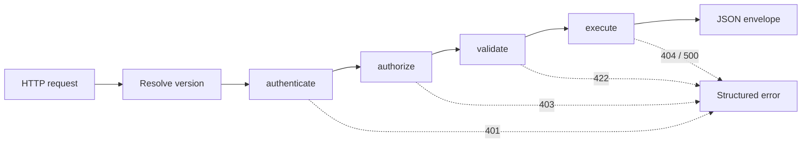

# config-driven-api-framework

A configuration-driven REST API framework for Node.js: declare an endpoint as **data**, and a shared middleware pipeline handles authentication, permissions, input validation, API versioning, pagination and the SQL. You write the part specific to your product; the framework does the rest.

It is distilled from the UBS framework I designed at Granjur — the same pipeline shape (authenticate → authorize → validate → execute), stripped down to a small, standalone, dependency-light core.

## The core idea

```js
defineApi({
  name: 'books.get',
  version: '1',
  method: 'GET',
  path: '/books/:id',
  auth: { required: true, permission: 'books:read' },
  params: { id: { type: 'integer', required: true, min: 1 } },
  query: {
    mode: 'one',
    sql: 'SELECT id, title, author FROM books WHERE id = :id AND deleted_at IS NULL',
  },
  response: { notFound: 'Book not found' },
});
```

That one declaration says who may call the endpoint, what input it accepts, which SQL it runs and what to return when nothing matches. No route handler, no token parsing, no hand-written validation.

Most endpoints are a query plus rules like this. When one needs real logic, it supplies a `handler` function instead of `query` and still gets the same auth, validation and versioning — see `auth.login` in [`examples/books.api.js`](examples/books.api.js), which checks a password and issues a token.

## Request flow



| Step | Responsibility |
|---|---|
| Resolve version | Picks the API version from the `X-API-Version` header, defaulting to the latest registered version |
| `authenticate` | Verifies the bearer token (JWT, HS256) and attaches the user to the request context |
| `authorize` | Checks the endpoint's declared permission against the user's permissions |
| `validate` | Merges, validates and coerces input; drops anything undeclared |
| `execute` | Runs the declarative query or custom handler, applies pagination/transform and normalizes the result |

Pipelines are built **once per route at startup**, and a step is left out when it does not apply (no `authorize` step on a public endpoint, for example).

## Design decisions

- **Declarative first, escape hatch second.** A `handler` function sits alongside `query` for the cases a query can't express, and still runs through auth, validation and versioning.
- **Fail at startup, not at request time.** `defineApi` rejects malformed definitions (bad method, missing query/handler, pagination on a non-list query) when the app boots.
- **Parameterized SQL only.** Queries use named placeholders (`:id`) compiled to the driver's placeholders — string literals and `::` casts are left alone, and user input is never concatenated into SQL.
- **Versioning without branching.** Several versions of one route live side by side in the registry; clients opt in with a header, and old versions keep working untouched.
- **Pluggable persistence.** Everything talks to a small `BaseDatabase` interface; the bundled driver runs on Node's built-in `node:sqlite`, and another one registers with `DatabaseFactory`.
- **Predictable responses.** Every success and error uses a fixed JSON envelope with a stable error code (`UNAUTHORIZED`, `FORBIDDEN`, `VALIDATION_FAILED`, `NOT_FOUND`, `BAD_REQUEST`, `INTERNAL`).

More detail in [`docs/architecture.md`](docs/architecture.md).

## Running the example

The example is a small bookshelf API: login, a paginated/searchable book list with two API versions, get-by-id, create and soft-delete, all on an in-memory SQLite database seeded with a couple of users and five books.

```bash
npm install
npm run demo   # walks the API through its main behaviours, prints one line per request
npm start       # same app, listening on :3000 — try GET /docs
```

`npm run demo` output:

```
401 list books without a token                    UNAUTHORIZED (Authentication required)
401 login with a wrong password                   UNAUTHORIZED (Wrong email or password)
200 login as reader                                token issued
200 login as admin                                 token issued
200 reader lists books, v1, page size 2            2 rows (page 1/3, total 5): The Pragmatic Programmer, Designing Data-Intensive Applicati...
200 reader searches books, v2 (latest)             2 rows (page 1/1, total 2): Designing Data-Intensive Applications, Database Internals
400 reader asks for API version 9                  BAD_REQUEST (Unsupported API version "9" {"supported":["1","2"]})
200 reader gets book 3                              {"id":3,"title":"Release It!","author":"Nygard","year":2007}
422 reader gets book "abc"                          VALIDATION_FAILED (id must be an integer)
403 reader tries to create a book                   FORBIDDEN (Missing permission: books:write)
422 admin creates with a too-short title            VALIDATION_FAILED (title needs at least 2 characters)
201 admin creates a book                             {"id":6}
200 admin deletes book 2                            {"deleted":2}
404 admin deletes book 2 again                       NOT_FOUND (Book not found)
401 tampered token                                   UNAUTHORIZED (Invalid token signature)
```

See [`examples/books.api.js`](examples/books.api.js) for the endpoint definitions and [`examples/app.js`](examples/app.js) for how they're wired into `createApp`.

## What is implemented

| Part | Status |
|---|---|
| `defineApi` (definition format and startup validation) | Implemented, tested |
| `ApiRegistry` (grouping, versions, `/docs` summary) | Implemented, tested |
| Error types (`ApiError` and helpers) | Implemented, tested |
| `createApp` (Express 5 app, pipeline wiring, error handling) | Implemented, tested |
| JWT auth (HS256, pinned algorithm, constant-time compare, expiry) | Implemented, tested |
| Password hashing (scrypt) | Implemented, tested |
| `compileNamed` (SQL named-placeholder compiler) | Implemented, tested |
| SQLite adapter (`node:sqlite`) | Implemented, tested |
| `validateParams` | Implemented, tested |
| Pipeline steps (authenticate, authorize, validate, execute) | Implemented, tested |

## Layout

```
src/
  index.js
  framework/
    defineApi.js        definition format and startup validation
    registry.js         route and version grouping
    errors.js           ApiError and helpers
    createApp.js        builds the Express app and wires the pipeline
    middlewares/        authenticate, authorize, validate, execute
    auth/               jwt.js, password.js
    db/                 BaseDatabase, DatabaseFactory, SqliteDatabase, namedParams (SQL compiler)
    params/             validateParams
examples/
  books.api.js          example endpoint definitions, two versions of one route
  app.js                wires the examples into createApp with an in-memory SQLite db
  demo.js                exercises the running app end to end, prints one line per request
docs/
  architecture.md
test/
```

## Running the tests

```bash
npm test
```

Requires Node 22.13 or newer (uses the built-in `node:sqlite` module). No runtime dependencies besides Express.

## License

MIT
